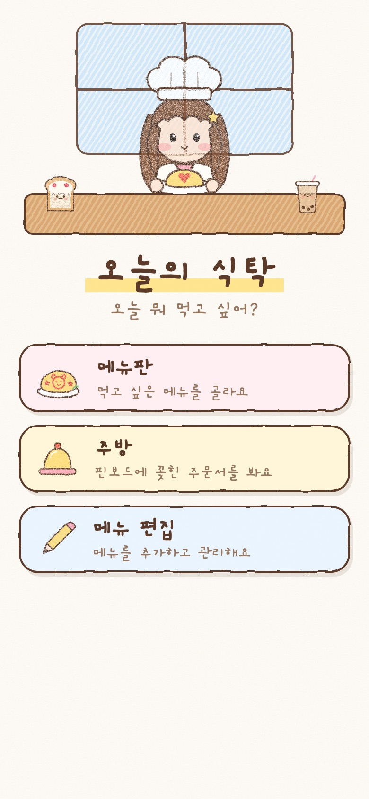
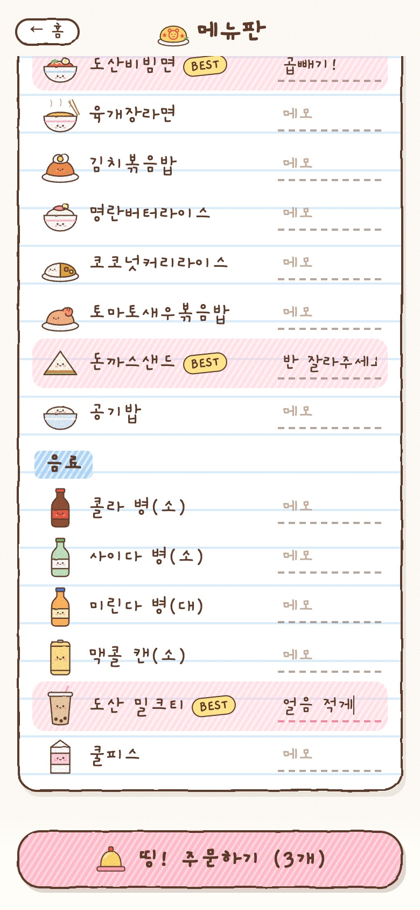
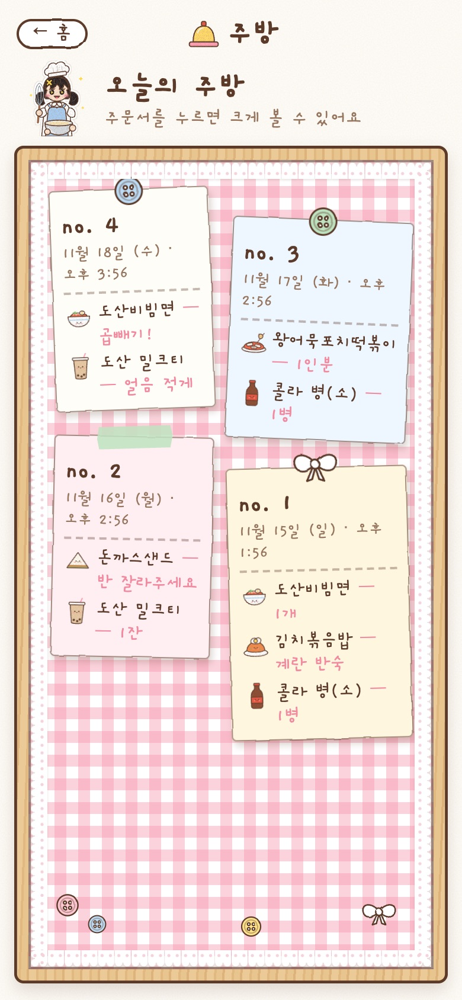
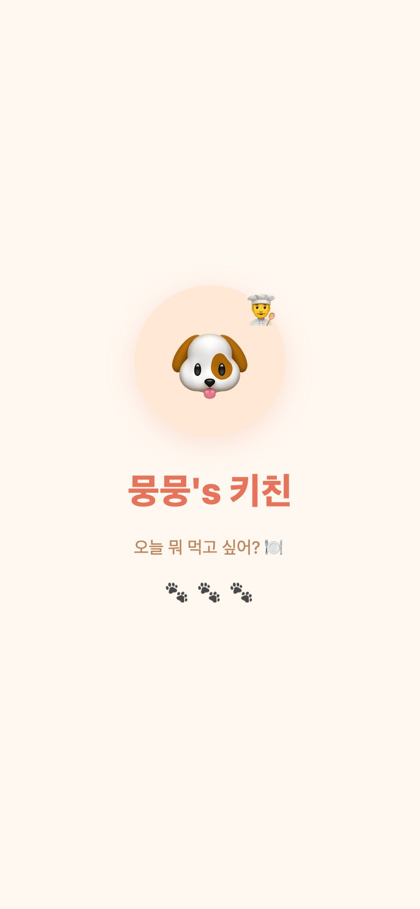
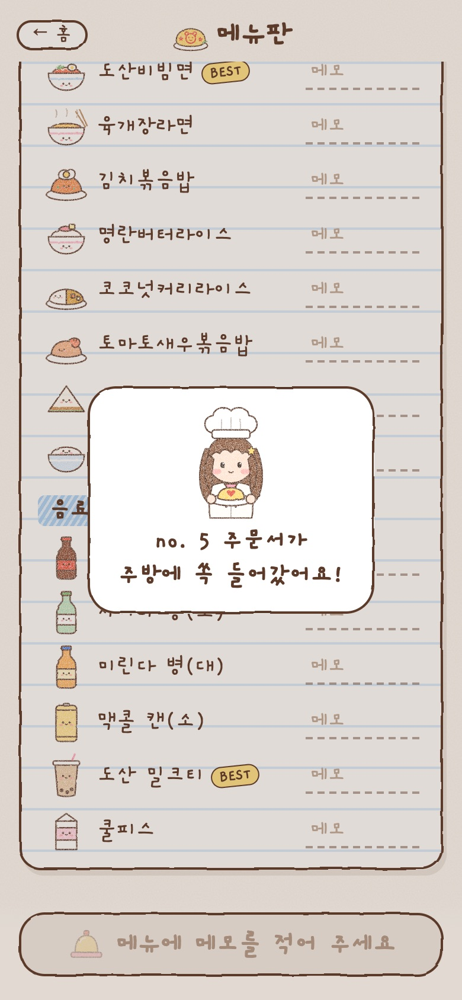
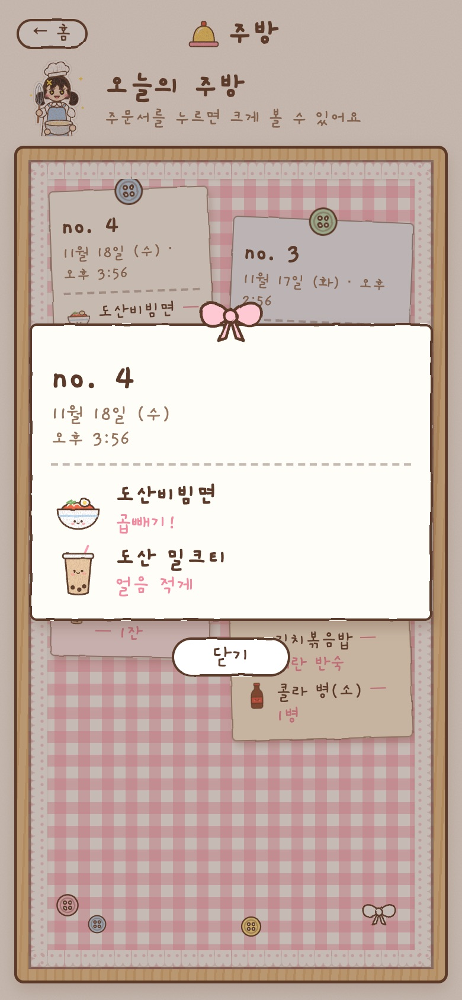
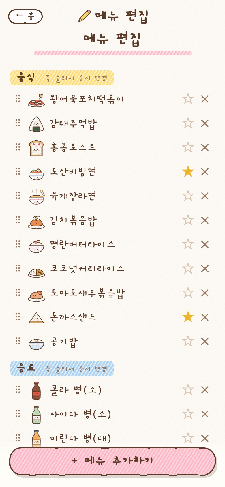

<div align="center">

# 🐶 뭉뭉식탁

**둘이 쓰는 우리집 메뉴판 & 주방 주문서** — 한 사람이 메뉴판에서 먹고 싶은 걸 고르면, 다른 사람의 주방 코르크보드에 메모지로 바로 붙는 모바일 웹앱

    

&nbsp;&nbsp;&nbsp;&nbsp;

</div>

---

## 📌 한눈에 보기

| | |
|---|---|
| **무엇을** | "오늘 뭐 먹지?"를 식당 주문처럼 — 메뉴판에서 메모를 남겨 주문하면 주방에 주문서가 붙는다 |
| **어떻게** | 주문은 Supabase(PostgreSQL)에 저장하고 **Realtime** 구독으로 두 기기에 바로 반영, 메뉴판은 기기별 `localStorage` |
| **특징** | 코르크보드·압정·메모지 UI, 주문 번호, 메뉴 BEST 표시, 터치 드래그로 메뉴 순서 변경 |

---

## 📱 화면

### 1. 시작 · 홈

<table>
<tr>
<td align="center" width="50%"></td>
<td align="center" width="50%"></td>
</tr>
<tr>
<td align="center"><sub><b>스플래시</b> — 2.8초 후 홈으로</sub></td>
<td align="center"><sub><b>홈</b> — 메뉴판 · 주방 · 메뉴 편집으로 이동</sub></td>
</tr>
</table>

### 2. 메뉴판 → 주문하기

<table>
<tr>
<td align="center" width="50%"></td>
<td align="center" width="50%"></td>
</tr>
<tr>
<td align="center"><sub>음식·음료별 메뉴에 <b>메모</b>("곱빼기!", "얼음 적게")를 적으면 그 줄이 강조되고, 버튼에 담은 개수가 표시</sub></td>
<td align="center"><sub><b>주문하기</b> → 주문 번호와 함께 접수 알림, 메모는 비워짐</sub></td>
</tr>
</table>

### 3. 주방 — 코르크보드 주문서

<table>
<tr>
<td align="center" width="50%"></td>
<td align="center" width="50%"></td>
</tr>
<tr>
<td align="center"><sub>들어온 주문이 압정 꽂힌 메모지로 붙음 (주문 번호 · 날짜 · 시간 · 메뉴와 메모). 메모지마다 살짝 다른 각도, 4장씩 페이지 넘김</sub></td>
<td align="center"><sub>메모지를 누르면 크게 보기</sub></td>
</tr>
</table>

### 4. 메뉴 편집

<table>
<tr>
<td align="center" width="50%"></td>
<td width="50%">

- ⠿ 핸들을 **꾹 눌러 드래그**해서 순서 변경 (터치 이벤트로 직접 구현)
- ☆ / ⭐ 로 **BEST** 메뉴 지정
- ✕ 로 삭제, 하단 버튼으로 메뉴 추가 (이름 · 음식/음료 · 이모지)

</td>
</tr>
</table>

> 스크린샷은 실제 DB 대신 샘플 주문 데이터로 찍었습니다.

---

## 🔄 동작 흐름

```
 [기기 A] 메뉴판 ──주문하기──▶ Supabase orders 테이블에 INSERT
                                     │
                                     │ postgres_changes (Realtime)
                                     ▼
 [기기 B] 주방 ◀── loadOrders() 다시 불러와 메모지 갱신 (polling 없음)
```

| 데이터 | 저장 위치 | 이유 |
|---|---|---|
| 주문 (`orders`) | Supabase PostgreSQL | 두 기기가 함께 봐야 함 → Realtime 구독 |
| 메뉴판 · 메모 입력 중 상태 | 기기별 `localStorage` | 서버 왕복 없이 바로 편집, 새로고침해도 유지 |

- 주문 번호는 `orders` 행 개수 + 1 로 매긴다.
- 주문서에는 그 시점의 메뉴 전체를 담고, 주방에서는 메모가 있는 메뉴만 보여 준다. 그래서 나중에 메뉴를 바꿔도 지난 주문서 내용은 그대로다.

---

## 🛠 기술 스택

| 영역 | 기술 |
|---|---|
| Frontend | React 18 (`useState` · `useEffect`), TypeScript, Vite |
| 스타일 | CSS 변수 기반 디자인 토큰, `transform: rotate()` 메모지, 코르크 도트 패턴 |
| Backend | Supabase — PostgreSQL + Realtime `postgres_changes` |
| 배포 | Vercel |

---

## 🗄 데이터베이스 스키마

```sql
create table orders (
  id           text primary key,
  order_number integer,
  items        jsonb not null,        -- 주문 당시 메뉴 + 메모
  created_at   timestamptz not null,
  rotation     float not null         -- 메모지 기울기 (-3° ~ 3°)
);
```

Realtime 을 쓰려면 Supabase 대시보드에서 `orders` 테이블의 Realtime 을 켜야 한다.

---

## 📂 프로젝트 구조

```
src/
├── App.tsx              # 화면 전환 (home | menu | kitchen | edit) + Realtime 구독
├── components/
│   ├── SplashScreen.tsx # 시작 화면
│   ├── HomeScreen.tsx   # 홈
│   ├── MenuTab.tsx      # 메뉴판 · 메모 · 주문하기
│   ├── KitchenTab.tsx   # 코르크보드 주문서 · 크게 보기 · 페이지
│   └── EditTab.tsx      # 메뉴 추가·삭제·BEST·드래그 정렬
├── storage.ts           # 기본 메뉴, localStorage, Supabase 조회·저장
├── supabase.ts          # Supabase 클라이언트
├── types.ts             # MenuItem, Order
└── app.css              # 전체 스타일
```

---

## 🚀 실행

```bash
npm install
npm run dev      # http://localhost:5173
npm run build    # dist/
```

Vercel 배포: `vercel --prod`
